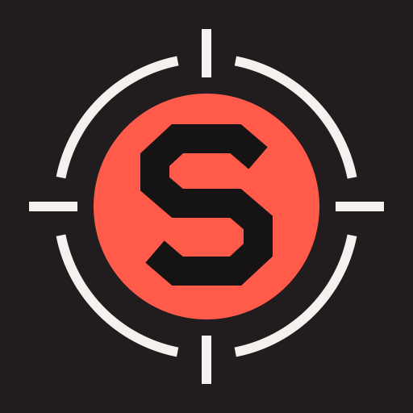
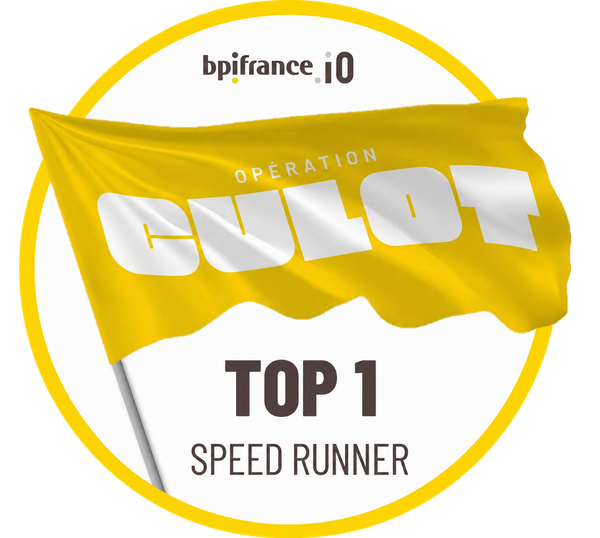
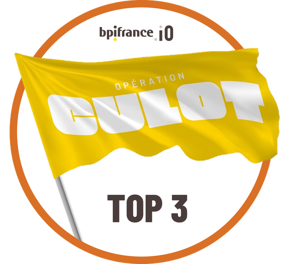
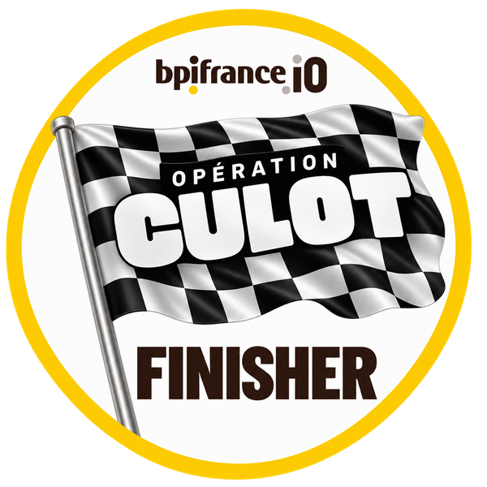
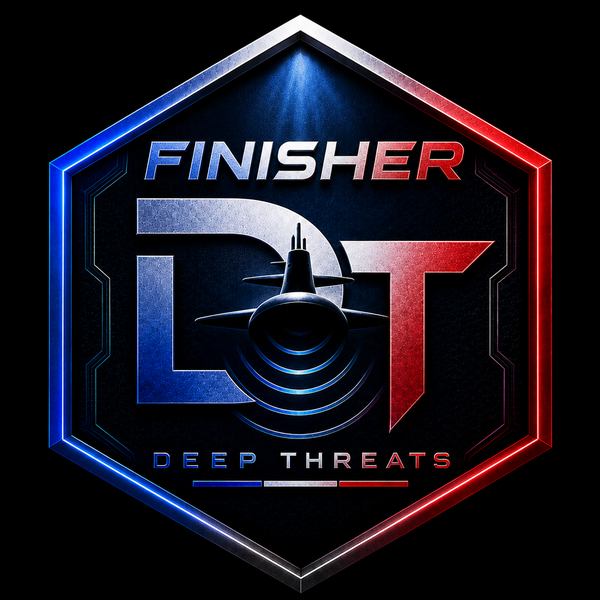
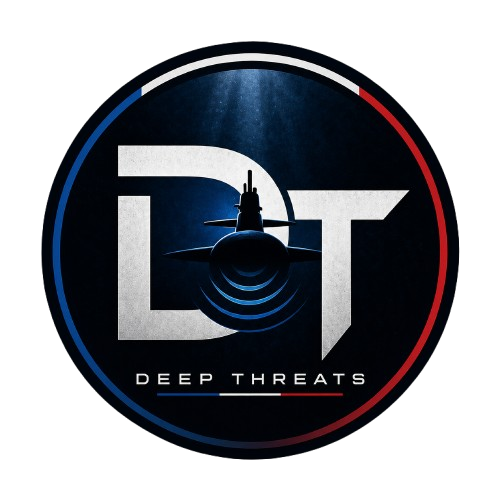

# Shakado

Member of the Corvus Mind OSINT team

**[View the portfolio](https://shsh-commits.github.io/shakado-portfolio/?lang=en) · [Voir le portfolio](https://shsh-commits.github.io/shakado-portfolio/?lang=fr)**

## Badges

<table><tr>
<td align="center" width="200"> <b>Opération Culot 2026 - 1st place Speed Runner</b> Les Blaireaux des Légendes</td>
<td align="center" width="200"> <b>Opération Culot 2026 - 3rd place online</b> Les Blaireaux des Légendes</td>
<td align="center" width="200"> <b>Opération Culot 2026 - Finisher</b> Les Blaireaux des Légendes</td>
<td align="center" width="200"> <b>Deep Threats - Finisher</b> Campus OSINT - DGA</td>
</tr></table>

## Certifications

<table>
<tr><td></td><td><a href="https://badgify.eu/certificate/wQY5dQMYldQsMA_qaHx7CKaeLYMHLo3U"><b>Opération Culot - Certificate of participation</b></a> Bpifrance.io · 3rd / 315 · 1900 points · Team Corvus Mind</td></tr>
<tr><td></td><td><a href="https://badgify.eu/certificate/IJD3WOE6BA5grcMJIT88QoHeRUlpSRWu"><b>Deep Threats - Certificate of participation</b></a> Campus OSINT - DGA · 25th / 491 · 2551 points · Team MASS</td></tr>
</table>

© 2026 Shakado

